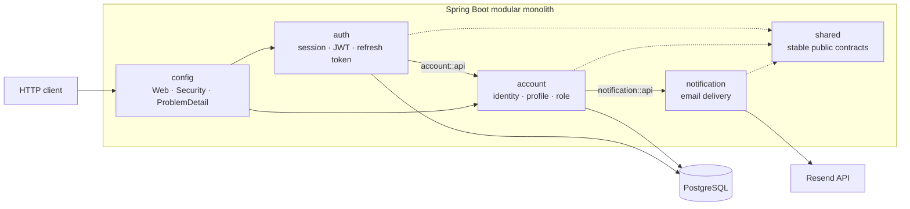

# Carmunity API

Carmunity는 자동차 정보 탐색과 자동차 정보에 연결된 커뮤니티를 목표로 개발 중인
Spring Boot 백엔드입니다. 현재는 account/auth 기반과 함께 **모듈 경계, 인증 보안,
품질 검증, immutable image 공급과 GitOps 배포 구조**를 갖춘 상태에서 제품 기능을
확장하고 있습니다.

이 README는 기능 목록보다 프로젝트에 적용한 설계 선택, 구성요소의 책임과 delivery
경계를 먼저 설명합니다. 제품 목표와 현재 구현 범위는
[100 제품 개요](docs/product/100-product-overview.md)와
[100 프로젝트 개요](docs/project/100-project-overview.md)에서 확인할 수 있습니다.

## Engineering goals

- 분산 시스템의 운영 비용 없이 업무 module의 변경 이유와 소유권을 분리합니다.
- 아키텍처 경계를 개발자 규율에만 맡기지 않고 자동화된 test로 검증합니다.
- Application build, image publish와 staging 배포 승인을 서로 다른 사건으로 분리합니다.
- Source revision부터 runtime image까지 변경할 수 없는 identity로 추적합니다.
- CI, AWS, Kubernetes와 database가 각자 필요한 최소 권한만 갖도록 trust boundary를 둡니다.
- 실패와 rollback도 Git에 남는 선언적 변경으로 처리합니다.

## Application architecture

현재 애플리케이션은 하나의 Spring Boot process로 배포되는 **Modular Monolith**이며,
각 업무 module 내부에는 **Hexagonal Architecture**를 적용합니다.



### Why this structure

| 선택지 | 장점 | 현재 판단 |
| --- | --- | --- |
| 전역 계층형 package | 초기 구조가 단순함 | 업무 경계가 기술 계층에 묻히고 module 내부 참조를 막기 어려움 |
| Modular Monolith + Hexagonal Architecture | 단일 배포·transaction을 유지하면서 업무와 adapter 경계를 분리함 | **현재 선택** |
| Microservices | 독립 배포와 장애 격리가 가능함 | 현재 규모에서는 network, 배포, 관측성과 transaction 비용이 더 큼 |

상태 변경, 권한, transaction과 외부 연동은 UseCase, Port, Adapter를 명확히 나눕니다.
반면 단순 조회에는 Read Model/Projection을 허용해 모든 흐름에 같은 추상화를 강제하지
않습니다. Spring Modulith의 `ApplicationModules.verify()`와 ArchUnit test는 module과
계층 경계를 실제 build에서 검증합니다.

선택의 전체 근거와 재검토 조건은
[200 현재 프로젝트 아키텍처](docs/project/200-current-architecture.md), 실제 package 책임과
예외는 [210 모듈 지도](docs/project/210-module-map.md)가 소유합니다.

## Module boundaries

| Module | 책임 | 외부 협력 경계 |
| --- | --- | --- |
| `account` | 인증 주체, profile, password, role, verification과 admin invitation | Email 전달을 `notification::api`에 위임 |
| `auth` | Session, JWT 발급·검증, refresh token rotation, logout | Account subject와 저장 경계를 `account::api`로 사용 |
| `notification` | Email 공개 API, template와 Resend adapter | Account 상태와 token lifecycle을 소유하지 않음 |
| `shared` | 여러 module이 실제로 공유하는 안정된 계약과 기반 type | 업무 로직을 모으지 않음 |
| `config` | Spring MVC, Security, OpenAPI, logging과 application 조립 | 업무 Bounded Context가 아님 |

Module은 다른 module의 `internal` 구현 대신 공개 API 또는 named interface로 협력합니다.
다만 현재 `account`와 `auth`가 일부 인증 table을 별도 persistence model로 함께 사용하는
예외가 있고, 공용 `Clock`의 조립 위치도 일관되지 않습니다. 이 제약은 숨기지 않고
[210 모듈 지도](docs/project/210-module-map.md)의 후속 owner와 함께 관리합니다.

## CI and quality gates

Pull request와 `main` push는 application 기본 품질 경계를 통과하고, 신뢰할 수 있는 `main`
revision만 image publish 후보가 됩니다. Trigger, branch 조건, CI·publish의 모든 step과
GitOps 인계는 [200 CI/CD pipeline](docs/project/infrastructure/200-ci-cd-pipeline.md)이
설명 SOT로 소유합니다. 구현 source는 [CI workflow](.github/workflows/ci.yml), 품질 도구의
세부 기준은 [310 코드 품질 도구](docs/tech-stack/310-code-quality-tools.md)에서 확인합니다.

## Container supply chain

성공한 `main` revision만 private ECR의 immutable ARM64 image가 될 수 있습니다. Workflow
admission·step·재실행은 [200 CI/CD pipeline](docs/project/infrastructure/200-ci-cd-pipeline.md),
OIDC trust와 IAM resource 관계는
[130 ECR·IAM image 공급 기반](docs/project/infrastructure/130-ecr-iam-foundation.md), image
identity·ARM64 build·kubelet pull은
[210 Container image delivery](docs/project/infrastructure/210-container-image-delivery.md)가
소유합니다. 구현 source는 [Publish image workflow](.github/workflows/publish-image.yml)와
[Dockerfile](Dockerfile)입니다.

## GitOps delivery

Image 게시와 staging 배포는 분리하며, review된 digest 변경 pull request가 deployment
intent를 만듭니다. 승인·reconciliation·migration·rollback state model은
[220 GitOps application delivery](docs/project/infrastructure/220-gitops-application-delivery.md),
전체 CI/CD 인계 순서는 [200 CI/CD pipeline](docs/project/infrastructure/200-ci-cd-pipeline.md),
실제 배포·복구 명령은
[420 GitOps 배포·rollback runbook](docs/operations/420-gitops-deployment-and-rollback-runbook.md)이
소유합니다. Manifest directory의 변경 경계와 빠른 탐색은
[Kubernetes application desired state](deploy/README.md)에서 시작합니다.

## Infrastructure and trust boundaries

현재 staging infrastructure의 topology와 component·trust boundary는
[100 Infrastructure overview](docs/project/infrastructure/100-infrastructure-overview.md)가
소유합니다. Repository의 구조·자동화 source가 존재한다는 사실은 실제 AWS나 cluster 배포
완료를 뜻하지 않으며, 현재 live 상태와 재개 위치는
[100 Staging 단일 node 전체 구축 시나리오](docs/operations/scenarios/100-staging-single-node-bootstrap.md)가
소유합니다.

## Trade-offs and current limitations

현재 선택은 운영 복잡도를 줄이는 대신 다음 제약을 받아들입니다.

- Application·cluster·environment가 각각 하나여서 source와 GitOps 설정을 같은 repository에
  둡니다. 관리 대상은 줄지만 repository read permission과 history를 분리하지 못합니다.
- Kubernetes control plane과 worker가 단일 EC2 node에 있어 high availability를 제공하지
  않습니다.
- AWS resource는 아직 Terraform으로 선언하지 않고 Console과 repository bootstrap
  interface의 경계로 관리합니다.
- Image digest 변경 pull request 자동 생성과 별도 Git write identity는 아직 구현하지
  않았습니다.
- Account/auth의 일부 persistence ownership과 공용 `Clock` 조립 경계는 후속 정리가 필요한
  알려진 예외입니다.

독립 배포·장애 격리가 실제로 필요해지거나, 단일 database transaction이 병목이 되거나,
서비스·environment·승인 주체와 repository permission을 분리해야 할 때 현재 architecture와
GitOps repository 경계를 재검토합니다.

## Evidence map

| 확인하려는 주장 | Canonical 설명 | 구현 source |
| --- | --- | --- |
| Architecture 선택과 재검토 조건 | [200 현재 프로젝트 아키텍처](docs/project/200-current-architecture.md) | `src/main`, architecture test |
| Module 책임과 알려진 예외 | [210 모듈 지도](docs/project/210-module-map.md) | `src/main/java/com/ronams/carmunity` |
| CI/CD 전체 흐름과 step | [200 CI/CD pipeline](docs/project/infrastructure/200-ci-cd-pipeline.md) | [CI workflow](.github/workflows/ci.yml), [Publish image workflow](.github/workflows/publish-image.yml) |
| Quality Gate 세부 기준 | [310 코드 품질 도구](docs/tech-stack/310-code-quality-tools.md) | `build.gradle`, `sonar-project.properties` |
| ARM64 image identity·build와 ECR pull | [210 Container image delivery](docs/project/infrastructure/210-container-image-delivery.md) | [Dockerfile](Dockerfile), `scripts/bootstrap/ecr` |
| 단일 node cluster와 workload network | [150 Kubernetes cluster](docs/project/infrastructure/150-kubernetes-cluster.md) | `scripts/bootstrap/kubernetes` |
| GitOps state와 rollback | [220 GitOps application delivery](docs/project/infrastructure/220-gitops-application-delivery.md) | `deploy`, `scripts/bootstrap/gitops` |
| Public HTTPS ingress와 AWS resource ownership | [170 AWS Load Balancer ingress](docs/project/infrastructure/170-aws-load-balancer-ingress.md) | `deploy/overlays/stg`, `scripts/bootstrap/load-balancer` |
| 전체 infrastructure 관계 | [100 Infrastructure overview](docs/project/infrastructure/100-infrastructure-overview.md) | `.github/workflows`, `deploy`, `scripts/bootstrap` |

## Run and verify locally

Architecture와 CI 경계를 가장 짧게 확인하려면 JDK 21과 Testcontainers가 사용할 Docker
daemon을 준비한 뒤 다음 명령을 실행합니다.

```sh
docker info
./gradlew check --no-daemon --rerun-tasks --console=plain
```

애플리케이션 실행에는 별도의 PostgreSQL과 실제 secret이 필요합니다.

```sh
./gradlew bootRun
```

기본 HTTP port는 `9097`이며 local profile의 Swagger UI는
`http://localhost:9097/swagger-ui.html`에서 확인할 수 있습니다. 환경변수 전체와 secret
기준은 [100 로컬 개발 환경](docs/development/100-local-development.md)을 따릅니다.
Staging은 `https://stg-api.example.com/swagger-ui.html`에서 기존 관리자 또는 최고 관리자
계정으로 로그인해 확인합니다. 환경별 노출·인증 조건과 OpenAPI JSON 경로는
[260 OpenAPI 문서화 가이드](docs/tech-stack/260-openapi.md)를 따릅니다.

전체 문서 탐색은 [000 문서 목차](docs/000-index.md), 실제 환경 구축·점검·복구는
[000 운영 문서 목차](docs/operations/000-index.md)에서 시작합니다.
