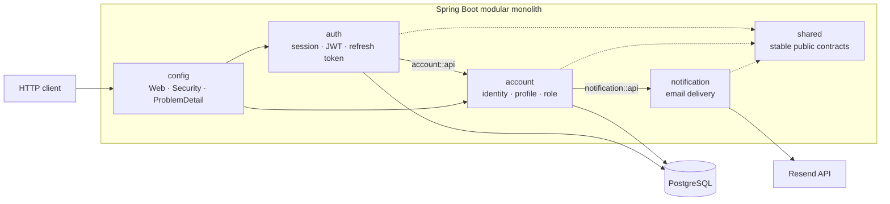

# Carmunity API

Carmunity는 자동차 정보 탐색과 자동차 정보에 연결된 커뮤니티를 목표로 개발 중인
Spring Boot 백엔드입니다. 현재는 전체 제품 기능을 확장하기 전에 account/auth 기반과
함께 **모듈 경계, 인증 보안, 품질 검증, immutable image 공급과 GitOps 배포 구조**를
구축하고 있습니다.

이 README는 기능 목록보다 프로젝트에 적용한 설계 선택, 구성요소의 책임과 delivery
경계를 먼저 설명합니다. 제품 목표와 현재 구현 범위는
[100 제품 개요](docs/product/100-product-overview.md)와
[100 프로젝트 개요](docs/project/100-project-overview.md)에서 확인할 수 있습니다.

## 공개 범위

이 저장소는 원본 저장소의 현재 구현과 문서를 공개 용도로 옮긴 사본입니다. 실제 운영 환경의
credential, endpoint, account·application 식별자와 자동 image 게시 권한은 예시값 또는
비활성 설정으로 대체했습니다. 코드, 테스트, 문서, 작업 기록과 AI 작업 규칙은 가능한 범위에서
동일하게 유지합니다.

## Engineering goals

- 분산 시스템의 운영 비용 없이 업무 module의 변경 이유와 소유권을 분리합니다.
- 아키텍처 경계를 개발자 규율에만 맡기지 않고 자동화된 test로 검증합니다.
- Application build, image publish와 staging 배포 승인을 서로 다른 사건으로 분리합니다.
- Source revision부터 runtime image까지 변경할 수 없는 identity로 추적합니다.
- CI, AWS, Kubernetes와 database가 각자 필요한 최소 권한만 갖도록 trust boundary를 둡니다.
- 실패와 rollback도 Git에 남는 선언적 변경으로 처리합니다.

## Application architecture

현재 애플리케이션은 하나의 Spring Boot process로 배포되는 **Modular Monolith**이며,
각 업무 module 내부에는 **Hexagonal Architecture**를 적용합니다.



### Why this structure

| 선택지 | 장점 | 현재 판단 |
| --- | --- | --- |
| 전역 계층형 package | 초기 구조가 단순함 | 업무 경계가 기술 계층에 묻히고 module 내부 참조를 막기 어려움 |
| Modular Monolith + Hexagonal Architecture | 단일 배포·transaction을 유지하면서 업무와 adapter 경계를 분리함 | **현재 선택** |
| Microservices | 독립 배포와 장애 격리가 가능함 | 현재 규모에서는 network, 배포, 관측성과 transaction 비용이 더 큼 |

상태 변경, 권한, transaction과 외부 연동은 UseCase, Port, Adapter를 명확히 나눕니다.
반면 단순 조회에는 Read Model/Projection을 허용해 모든 흐름에 같은 추상화를 강제하지
않습니다. Spring Modulith의 `ApplicationModules.verify()`와 ArchUnit test는 module과
계층 경계를 실제 build에서 검증합니다.

선택의 전체 근거와 재검토 조건은
[200 현재 프로젝트 아키텍처](docs/project/200-current-architecture.md), 실제 package 책임과
예외는 [210 모듈 지도](docs/project/210-module-map.md)가 소유합니다.

## Module boundaries

| Module | 책임 | 외부 협력 경계 |
| --- | --- | --- |
| `account` | 인증 주체, profile, password, role, verification과 admin invitation | Email 전달을 `notification::api`에 위임 |
| `auth` | Session, JWT 발급·검증, refresh token rotation, logout | Account subject와 저장 경계를 `account::api`로 사용 |
| `notification` | Email 공개 API, template와 Resend adapter | Account 상태와 token lifecycle을 소유하지 않음 |
| `shared` | 여러 module이 실제로 공유하는 안정된 계약과 기반 type | 업무 로직을 모으지 않음 |
| `config` | Spring MVC, Security, OpenAPI, logging과 application 조립 | 업무 Bounded Context가 아님 |

Module은 다른 module의 `internal` 구현 대신 공개 API 또는 named interface로 협력합니다.
다만 현재 `account`와 `auth`가 일부 인증 table을 별도 persistence model로 함께 사용하는
예외가 있고, 공용 `Clock`의 조립 위치도 일관되지 않습니다. 이 제약은 숨기지 않고
[210 모듈 지도](docs/project/210-module-map.md)의 후속 owner와 함께 관리합니다.

## CI and quality gates

모든 pull request와 `main` push는 같은 application 기본 품질 경계를 통과합니다.

```mermaid
flowchart LR
    Change["Pull request / main push"] --> CI["CI<br/>contents: read"]
    CI --> Docker["Docker daemon check"]
    Docker --> Gradle["Gradle check<br/>unit · integration · architecture · coverage · format"]
    Gradle --> Scope{"Trusted revision?"}
    Scope -->|"enabled same repository / main"| Sonar["SonarQube Cloud<br/>Quality Gate"]
    Scope -->|"fork / Dependabot PR"| PRDone["Basic CI complete"]
    Sonar --> Verified["Application quality verified"]
    Verified -->|"main push only"| Decision["before..after range classifier"]
    Verified -->|"pull request"| PRDone
    Decision --> Artifact["SHA · run-attempt bound<br/>publish decision artifact"]
    Artifact --> Publish["Publish image workflow"]
```



- CI는 repository source만 읽으며 AWS나 cluster credential을 갖지 않습니다.
- PostgreSQL integration test가 조용히 생략되지 않도록 먼저 Docker daemon을 확인합니다.
- `./gradlew check --rerun-tasks`로 이전 task 결과를 재사용하지 않고 전체 검증을 실행합니다.
- Fork와 Dependabot pull request는 secret을 받지 않으므로 기본 검증은 유지하고 Sonar만
  사유를 기록한 뒤 건너뜁니다.
- `SONAR_ENABLED=true`로 활성화한 same-repository pull request와 `main`에서는 Sonar 설정이나
  token이 없으면 실패하며, 분석 revision의 Quality Gate 결과를 기다립니다.
- `main` push의 마지막 commit이 아니라 `before..after` 전체 변경을 분류해 image publish
  여부를 exact CI run의 artifact로 전달합니다.

구현 source는 [CI workflow](.github/workflows/ci.yml), 품질 도구의 현재 기준은
[310 코드 품질 도구](docs/tech-stack/310-code-quality-tools.md)에서 확인할 수 있습니다.

## Container supply chain

`AWS_ECR_PUBLISH_ENABLED=true`로 활성화한 경우, 성공한 `main` revision만 private ECR의
ARM64 image가 될 수 있습니다.

| Control | 적용 방식 |
| --- | --- |
| Build input 고정 | Dockerfile frontend와 builder·runtime base image를 digest로 고정 |
| Runtime 최소화 | Multi-stage build로 JRE와 application JAR만 runtime image에 포함 |
| Non-root process | 고정 UID/GID `10001`로 application 실행 |
| Source identity | 40자리 Git SHA를 immutable ECR tag와 OCI revision으로 사용 |
| Content identity | 배포와 pull에는 mutable tag가 아닌 `sha256` digest 사용 |
| AWS authentication | 장기 access key 대신 GitHub OIDC의 단기 push role 사용 |
| Privilege admission | 성공한 exact CI run의 검증된 분류 artifact가 있을 때만 AWS 권한 발급 |
| Re-run safety | 같은 SHA image가 있으면 다시 push하지 않고 기존 digest 재사용 |

Target과 같은 native ARM64 runner에서 image를 만들며 QEMU 변환을 사용하지 않습니다.
GitHub Actions와 image build source는 commit SHA로 고정합니다. 실제 계약은
[Publish image workflow](.github/workflows/publish-image.yml), [Dockerfile](Dockerfile)과
[200 Container image delivery](docs/project/infrastructure/200-container-image-delivery.md)가
소유합니다.

## GitOps delivery

Image 게시와 staging 배포는 의도적으로 분리합니다. Publish workflow는 runtime artifact만
만들고, 사람이 검토한 별도의 digest 변경 pull request가 deployment intent를 만듭니다.

```mermaid
flowchart LR
    Source["Source PR"] --> Main["main"]
    Main --> CI["CI success"]
    CI --> ECR["Private ECR<br/>immutable ARM64 digest"]
    ECR --> DeployPR["deploy/overlays/stg<br/>digest change PR"]
    DeployPR -->|"review · merge"| Git["Git desired state"]
    Git --> Argo["Argo CD Core<br/>read-only pull"]
    Argo --> Migration["PreSync migration Job<br/>migrator credential"]
    Migration --> Runtime["Deployment · Service<br/>runtime credential"]
    Runtime --> Health["No condition<br/>Synced · Healthy"]
```



- Argo CD는 `deploy/overlays/stg`를 pull하며 GitHub Actions가 cluster credential을 소유하지
  않습니다.
- Automated sync, `prune`과 `selfHeal`은 활성화하지만 `allowEmpty`는 비활성화해 잘못 빈
  render가 전체 삭제로 이어지는 것을 막습니다.
- Migration Job은 runtime과 같은 immutable image를 사용하지만 migrator credential만
  받습니다. Migration과 권한 callback이 성공해야 runtime Deployment가 sync됩니다.
- Runtime Pod에는 Flyway를 비활성화하고 runtime database credential만 제공합니다.
- Rollback은 live Deployment patch가 아니라 이전 정상 digest를 되돌리는 새 pull request로
  수행합니다. 이미 적용된 database migration은 되돌리지 않으므로 이전 image의 schema
  backward compatibility가 필요합니다.

전체 state model과 실패 경계는
[210 GitOps application delivery](docs/project/infrastructure/210-gitops-application-delivery.md),
실제 배포·복구 명령은
[420 GitOps 배포·rollback runbook](docs/operations/420-gitops-deployment-and-rollback-runbook.md)이
소유합니다.

## Infrastructure and trust boundaries

현재 repository가 표현하는 staging infrastructure 모델은 public subnet의 단일 Kubernetes
node, private ECR, private subnet의 RDS 배치 후보와 Argo CD Core를 연결합니다.

```text
AWS VPC
├── public subnet: EC2 single Kubernetes control-plane + worker
├── private subnets: RDS placement candidate
└── private ECR: immutable ARM64 application image

GitHub CI ──publish decision──> GitHub OIDC push role ──> ECR
EC2 kubelet ──instance profile pull role────────────────> ECR
Argo CD ──read-only GitHub App──> deploy/overlays/stg
Application Pod ──runtime DB role───────────────────────> RDS
Migration Job ──migrator DB role────────────────────────> RDS
```

Source SHA, ECR digest, GitOps commit과 Kubernetes live resource는 서로 다른 identity와
책임을 갖습니다. AWS Console 운영자, local bootstrap 운영자, GitHub Actions, kubelet,
Argo CD, Migration Job과 Application Pod도 credential을 공유하지 않습니다.

Repository의 구조·자동화 source가 존재한다는 사실은 실제 AWS나 cluster 배포 완료를
뜻하지 않습니다. 전체 actor·artifact·permission 관계는
[300 Infrastructure system](docs/project/300-infrastructure-system.md), staging의 현재 live
상태와 재개 위치는
[100 Staging 단일 node 전체 구축 시나리오](docs/operations/scenarios/100-staging-single-node-bootstrap.md)가
각각 소유합니다.

## Trade-offs and current limitations

현재 선택은 운영 복잡도를 줄이는 대신 다음 제약을 받아들입니다.

- Application·cluster·environment가 각각 하나여서 source와 GitOps 설정을 같은 repository에
  둡니다. 관리 대상은 줄지만 repository read permission과 history를 분리하지 못합니다.
- Kubernetes control plane과 worker가 단일 EC2 node에 있어 high availability를 제공하지
  않습니다.
- AWS resource는 아직 Terraform으로 선언하지 않고 Console과 repository bootstrap
  interface의 경계로 관리합니다.
- Image digest 변경 pull request 자동 생성과 별도 Git write identity는 아직 구현하지
  않았습니다.
- Account/auth의 일부 persistence ownership과 공용 `Clock` 조립 경계는 후속 정리가 필요한
  알려진 예외입니다.

독립 배포·장애 격리가 실제로 필요해지거나, 단일 database transaction이 병목이 되거나,
서비스·environment·승인 주체와 repository permission을 분리해야 할 때 현재 architecture와
GitOps repository 경계를 재검토합니다.

## Evidence map

| 확인하려는 주장 | Canonical 설명 | 구현 source |
| --- | --- | --- |
| Architecture 선택과 재검토 조건 | [200 현재 프로젝트 아키텍처](docs/project/200-current-architecture.md) | `src/main`, architecture test |
| Module 책임과 알려진 예외 | [210 모듈 지도](docs/project/210-module-map.md) | `src/main/java/com/ronams/carmunity` |
| CI와 Quality Gate | [310 코드 품질 도구](docs/tech-stack/310-code-quality-tools.md) | [CI workflow](.github/workflows/ci.yml), `build.gradle` |
| ARM64 image publish와 ECR pull | [200 Container image delivery](docs/project/infrastructure/200-container-image-delivery.md) | [Publish image workflow](.github/workflows/publish-image.yml), [Dockerfile](Dockerfile) |
| GitOps state와 rollback | [210 GitOps application delivery](docs/project/infrastructure/210-gitops-application-delivery.md) | `deploy`, `scripts/bootstrap/gitops` |
| 전체 infrastructure 관계 | [300 Infrastructure system](docs/project/300-infrastructure-system.md) | `.github/workflows`, `deploy`, `scripts/bootstrap` |

## Run and verify locally

Architecture와 CI 경계를 가장 짧게 확인하려면 JDK 21과 Testcontainers가 사용할 Docker
daemon을 준비한 뒤 다음 명령을 실행합니다.

```sh
docker info
./gradlew check --no-daemon --rerun-tasks --console=plain
```

애플리케이션 실행에는 별도의 PostgreSQL과 실제 secret이 필요합니다.

```sh
./gradlew bootRun
```

기본 HTTP port는 `9097`이며 local profile의 Swagger UI는
`http://localhost:9097/swagger-ui.html`에서 확인할 수 있습니다. 환경변수 전체와 secret
기준은 [100 로컬 개발 환경](docs/development/100-local-development.md)을 따릅니다.

전체 문서 탐색은 [000 문서 목차](docs/000-index.md), 실제 환경 구축·점검·복구는
[000 운영 문서 목차](docs/operations/000-index.md)에서 시작합니다.
